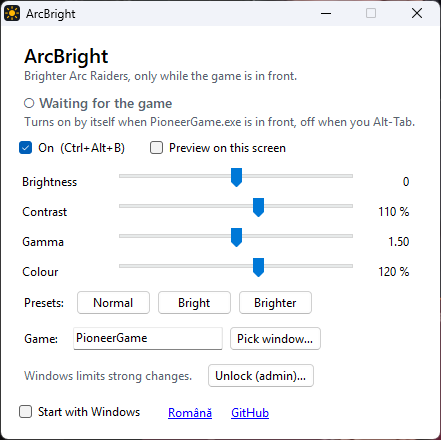

<p align="center"></p>

<h1 align="center">ArcBright</h1>

<p align="center"><b>Brighter Arc Raiders, only while the game is in front.</b><br>
Brightness, contrast, gamma and colour. Alt-Tab and your screen is back to normal.</p>

<p align="center"></p>

Arc Raiders has no gamma slider, and NVIDIA's game filters are blocked in it. ArcBright changes the picture at the display level instead, and only while the game's window is in front:

- **Gamma, brightness, contrast** through the Windows gamma ramp. Works on every GPU, in fullscreen and borderless.
- **Colour (saturation)** through the AMD driver, the same setting as *Custom Color → Saturation* in AMD Software: Adrenalin. Needs an AMD Radeon card.
- **Only on the game's screen.** With two monitors, the other one is left alone.
- **Off on Alt-Tab**, back on when you return to the game. Also off when you exit ArcBright. If it is ever killed while on, it puts the screen back the next time it starts.
- One small EXE, no installation, no runtime to download. English and Romanian.

## Download and start

1. Download `ArcBright.exe` from **[Releases](../../releases/latest)** and start it.
2. Windows may show *"Windows protected your PC"* because the EXE is not signed. Click **More info → Run anyway**. Or build it yourself from source, see below.
3. Move **Gamma** first: it lifts the shadows, so you see into dark corners without washing out the sky. Or click a preset: *Bright* or *Brighter*.
4. Start Arc Raiders. The status turns green, *Active*, while the game is in front.

Tick **Preview on this screen** to see the settings on your desktop while you tune them. Close the window and ArcBright keeps running next to the clock; right-click the sun icon to exit. **Start with Windows** starts it there, hidden.

| Key | Does |
|---|---|
| Ctrl + Alt + B | ArcBright on / off, also in the game |

**Other games:** type the game's process name in *Game*, or click **Pick window…** and switch to the game within 5 seconds. Several names: separate with commas. Arc Raiders is `PioneerGame`.

## Full brightness range (optional)

Windows refuses very strong gamma curves unless one registry value is set. The presets work without it; the far ends of the sliders need it. **Unlock (admin)…** sets it after a Windows admin prompt, and it takes effect after one restart. It is the value display calibration tools use:

```
HKLM\SOFTWARE\Microsoft\Windows NT\CurrentVersion\ICM  ->  GdiIcmGammaRange = 256 (DWORD)
```

## Good to know

- **HDR must be off** in Windows for the gamma part. With HDR on, Windows ignores gamma ramps.
- **Night light** and other gamma tools (f.lux, BrightRaider, monitor software) fight over the same ramp. Use one at a time.
- **Colour on NVIDIA or Intel** is not supported. Brightness, contrast and gamma work on any card.

## Anti-cheat

ArcBright does **not** touch the game: no injection, no reading or writing game memory, no files changed, no input sent. It reads which window is in front and its process name from the Windows process list, then changes the display's gamma ramp and the AMD driver's saturation, like a control panel would. No anti-cheat vendor has confirmed or ruled anything out for tools like this, so use it at your own risk.

## How it works

| File | Does |
|---|---|
| [`src/Engine.cs`](src/Engine.cs) | Watches the window in front (`SetWinEventHook`, plus a 1 s check) and turns the colours on or off |
| [`src/GammaController.cs`](src/GammaController.cs) | Builds the curve on top of the display's own ramp, `SetDeviceGammaRamp`, steps back if Windows refuses |
| [`src/AmdColor.cs`](src/AmdColor.cs) | AMD Display Library (`atiadlxx.dll`): finds the AMD display behind the Windows screen, sets saturation |
| [`src/Recovery.cs`](src/Recovery.cs) | Saves the original values to disk while a change is on, restores them after a crash |
| [`src/MainForm.cs`](src/MainForm.cs) | The window, tray icon, hotkey and settings |

Settings are kept in `%APPDATA%\ArcBright\settings.ini`.

**Something wrong?** Run `ArcBright.exe --diag` and attach `%APPDATA%\ArcBright\diag.txt` to an [issue](../../issues). It lists your screens, what Windows accepts and what the AMD driver reports, and the screen flashes briefly while it tests.

## Build it yourself

Windows already has the compiler. Run `build.cmd`; it writes `bin\ArcBright.exe`.

## Remove it

Untick *Start with Windows*, right-click the tray icon → *Exit*, delete `ArcBright.exe` and `%APPDATA%\ArcBright`. Optionally delete `GdiIcmGammaRange` from the registry key above.

---

## Română

**Arc Raiders mai luminos, doar cât timp jocul e în față.** Luminozitate, contrast, gamma și culoare; la Alt-Tab ecranul revine la normal.

1. Descarcă `ArcBright.exe` din **[Releases](../../releases/latest)** și pornește-l. Dacă Windows zice *„Windows protected your PC”*: **More info → Run anyway**.
2. Mută întâi **Gamma**: luminează umbrele fără să ardă cerul. Sau apasă *Luminos* / *Foarte luminos*.
3. Pornește jocul: starea devine verde, *Activ*, cât timp jocul e în față.

- **Culoarea** merge doar pe plăci AMD Radeon; luminozitatea, contrastul și gamma pe orice placă.
- **Ctrl + Alt + B** pornește / oprește, și din joc.
- Închizi fereastra și ArcBright rămâne lângă ceas; click dreapta pe soare → *Ieșire*.
- **HDR** trebuie să fie oprit în Windows.
- **Deblochează (admin)…** permite valori mai mari; funcționează după o repornire.
- Nu atinge jocul: nu injectează nimic, nu citește memoria jocului, nu apasă taste. Totuși, folosește-l pe propria răspundere.

---

Inspired by tools like BrightRaider and VibranceGUI; the code here is written from scratch. ArcBright is not affiliated with Embark Studios. Arc Raiders is a trademark of its owner. [MIT License](LICENSE).
